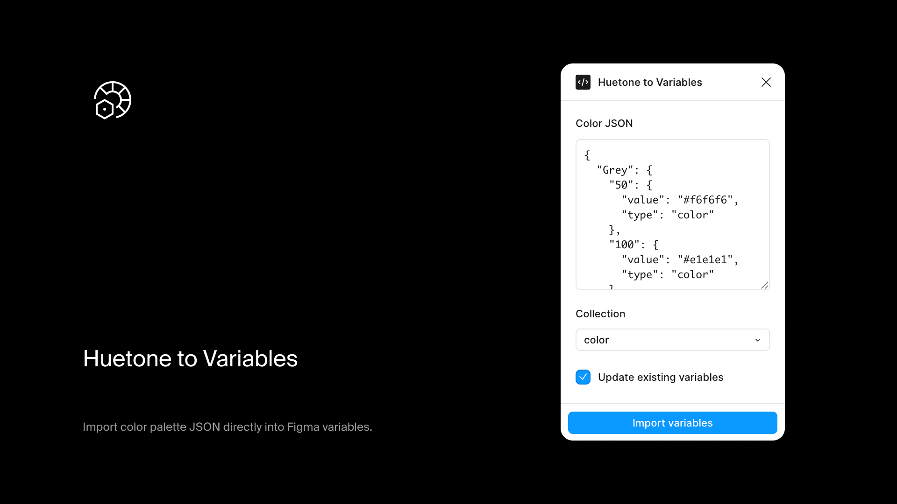

# Huetone to Variables

A Figma plugin for importing [Huetone](https://huetone.ardov.me/) and GitHub Prism color palettes directly into Figma variables.

## Install

Get it from the [Figma Community](https://www.figma.com/community/plugin/1419000403251649467/huetone-to-variables)

## What it does

Takes the JSON export from Huetone or Prism and creates color variables in Figma, organized by palette name and shade. Supports adding to an existing collection or creating a new one, with optional overwrite for existing values.

## Usage

1. Export your palette as JSON from Huetone or Prism
2. Run the plugin
3. Paste the JSON into the text area
4. Select an existing collection or create a new collection
5. Click import

For each screen and what its controls do, see the [user guide](https://figma-plugins.notion.site/Huetone-to-Variables-3ecf29c09c9d81dba9aaf015e9396e68). <!-- dev -->

## Options

- **Select collection** - Add variables to an existing collection
- **Create new collection** - Create a fresh collection for the import
- **Overwrite existing** - Update values if variables already exist

## Development

```bash
npm install
npm run dev    # Watch mode
npm run build  # Production build
```
