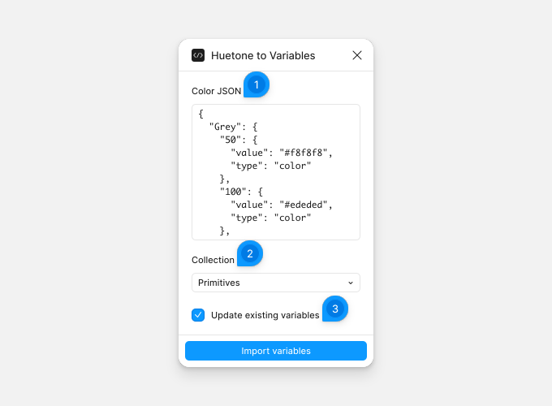

# Huetone to Variables

Huetone to Variables turns a color palette from Huetone or GitHub Prism into color variables. The shade `50` of the palette `Grey`, for example, becomes the variable `Grey/50`.

## Import a palette

Export the palette as JSON from Huetone or Prism, then run the plugin.

1. **Color JSON** — paste the exported palette.
2. **Collection** — a collection that already holds color variables. **Create new collection…** creates one with the **New collection name**.
3. **Update existing variables** — gives existing variables the palette's values. Without it, they keep their values.

Click **Import variables** to add the missing variables to the collection's first mode. Press Ctrl/Cmd+Z to undo.

A Prism color can be one hex value or a list, which becomes numbered variables from `0`: `blue/0`, `blue/1`. Only six-digit hex values import, such as `#f8f8f8`. If the JSON can't be read, you see an error; fix the JSON and try again.
